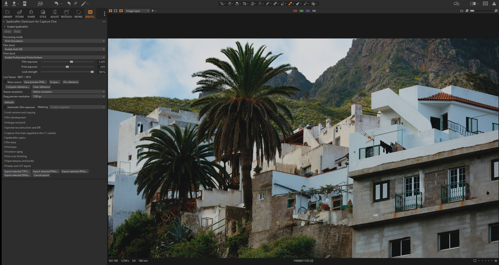
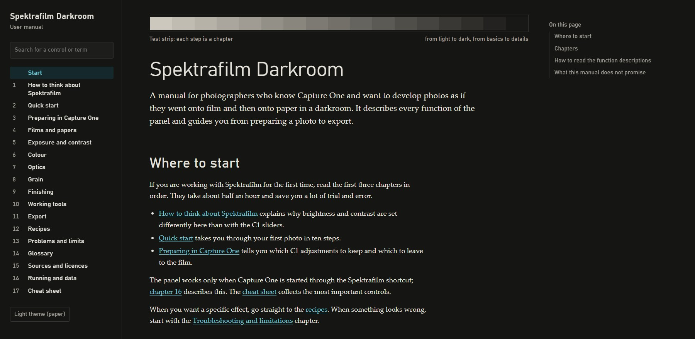

# Spektrafilm Darkroom for Capture One

An unofficial panel for Capture One 16.9 that renders a spectral simulation of colour negative film and its print, live in the Viewer and on export.



**This is a modified version (fork) of [Spektrafilm for Capture One](https://github.com/nothing-complex/spektrafilm-for-capture-one) by Luka Kauzlaric.** It started from the original's experimental branch on 14 November 2026, was moved to Capture One 16.9 and extended with a faster Viewer, look history, post-scan finishing, export through Capture One's own recipes and more; see [UPSTREAM-CHANGES.md](UPSTREAM-CHANGES.md). The original is developed separately and supports Capture One 16.4: if that is your version, use the original. The film and paper models come from [spektrafilm](https://github.com/andreavolpato/spektrafilm) by Andrea Volpato; the GPU renderer is built from the spektrafilm OFX plug-in by Aedan Diez.

> **Unofficial project.** It is not made, endorsed or supported by Capture One A/S. The panel loads into Capture One through a .NET startup hook and uses internal, undocumented interfaces of Capture One 16.9. A Capture One update can break it at any time, and using it may not be compatible with your Capture One licence terms. You use it at your own risk. This repository contains no Capture One files.

## What it does

- A tool tab in Capture One with film stock, print stock, film and print exposure, look strength and the usual darkroom controls (development, enlarger filtration, preflash, print base, emulsion aging).
- **Live Viewer:** the photo shown in Capture One's Viewer is the film simulation of your current Capture One development. Viewer resolution follows the zoom; quick frames keep sliders responsive.
- **Optics and grain:** halation, emulsion scatter, camera and print diffusion filters, several grain models, scanner simulation.
- **Post-scan finishing:** exposure, contrast, micro contrast, curves, toning, scan geometry, paper textures and borders.
- **Export through Capture One's recipes:** Capture One's own Export writes the Spektrafilm image with every active recipe: location and file names with tokens, JPEG, TIFF, PNG, PSD and PSB, the recipe's ICC profile and size, the photo's metadata, watermarks, output sharpening and the crop as a path. The files are listed before the export starts, each photo is rendered once per group of compatible recipes, and an interrupted export can be resumed.
- **Panel export:** 16-bit TIFF/PNG, JPEG and linear DNG of selected variants with each variant's own settings; colour-only LUT export (.cube, Hald CLUT, OCIO bundle).
- Settings are stored per variant, outside Capture One's own settings, with undo, named look versions, presets and copy/apply between photos.

## Requirements

- Windows 11, 64-bit. Windows 10 is untested.
- Capture One **16.9.0.3894** for Windows. This is the only tested version; the launcher warns when it finds another one.
- A GPU with Vulkan 1.1 support.

## Install

1. Download the ZIP from [Releases](../../releases) and extract it.
2. Close Capture One and run `Install Spektrafilm Darkroom for Capture One.cmd`. It copies a portable installation to your user profile and creates a desktop shortcut.
3. Start Capture One with the **Spektrafilm Darkroom for Capture One** shortcut and choose a catalog or session. The launcher backs up the catalog database and your saved looks first. Starting Capture One the normal way loads it without the panel.

`Start-Spektrafilm.ps1 -CheckOnly` in the installation folder checks the installation and runs a short Vulkan render without starting Capture One.

The panel keeps its settings, looks and log in `%LOCALAPPDATA%\FilmToolsForCaptureOne`, the same folder the original project uses. If you have used the original, back up that folder first and do not use both projects on the same catalog. Nothing is sent over the network.

## User manual

[](docs/manual-en/index.html)

A full user manual in English describes every control, with example images: [docs/manual-en](docs/manual-en/index.html). It is plain HTML that works offline; open `index.html` in a browser after downloading the repository, or open `manual\index.html` in the installation folder (the release package includes it). Its example photos are the author's own photo of a village and CC0 images from discuss.pixls.us, listed in the manual's chapter "Sources and licences".

## Recommended Capture One preparation

Set white balance, exposure, lens corrections, noise reduction and crop in Capture One, and leave curves, styles and colour grading neutral: the film and paper provide the tone curve. In the panel, **Input preparation = Neutral for film** develops the image for the simulation with Capture One's Linear Response curve and without its sharpening. Restore sharpness with the scanner controls (Spektrafilm optics › Scanning).

## Build from source

You need:

- [.NET SDK 10](https://dotnet.microsoft.com/) (the panel),
- Visual Studio 2022 C++ build tools and CMake (the renderer),
- the [Vulkan SDK](https://vulkan.lunarg.com/) (`VULKAN_SDK` set),
- 64-bit Python 3.13 with the packages in `requirements-build.txt` (generated profile data),
- an installed Capture One 16.9: the panel is built against its managed assemblies, which are referenced and never copied.

```powershell
.\Build-Windows.ps1 -BuildPanel -StageRuntime
.\Package-Windows.ps1 -Version 1.0.0
```

The first command builds the renderer and the panel and stages a runtime in the repository folder (`-CaptureOneDirectory` if Capture One is not in `C:\Program Files\Capture One\Capture One`). The second creates the portable ZIP in `dist`. Python with `requirements-lut.txt` is needed only for the optional LUT export (`Setup LUT Export.cmd`).

## Tests

`tests/` holds independent test programs (C#, C++ and Python); see [tests/README.md](tests/README.md).

## Contributing

Bug reports, suggestions and pull requests are welcome; see [CONTRIBUTING.md](CONTRIBUTING.md). When you report a problem, include your Capture One version, your GPU and the relevant lines of `%LOCALAPPDATA%\FilmToolsForCaptureOne\panel.log`. Report security problems privately as described in [SECURITY.md](SECURITY.md). Fixes that also apply to the original project are best offered there as well.

## Credits

This panel only connects other people's work to Capture One.

- **Andrea Volpato** created [spektrafilm](https://github.com/andreavolpato/spektrafilm), the spectral simulation of film and print, and built its film and paper profiles from real sensitometry and dye data.
- **Aedan Diez** built [spektrafilm OFX](https://spektrafilm.114c.de/) ([source](https://github.com/chaert-s/spektrafilm-ofx)), the GPU-accelerated port of that engine for OpenFX hosts such as DaVinci Resolve. Its Vulkan renderer is what makes interactive use possible here.
- **Luka Kauzlaric** wrote the original [Spektrafilm for Capture One](https://github.com/nothing-complex/spektrafilm-for-capture-one), from which this project started.

Both spektrafilm and spektrafilm OFX are worth exploring on their own.

This fork was programmed together with **Claude**, Anthropic's AI model, working in Claude Code: it wrote much of the code, the tests and the manual under the author's direction, and the author decided what to build and tried the results in Capture One.

## Licence

- Code: **GNU GPL version 3** ([LICENSE](LICENSE)).
- Film and paper profile data: **CC BY-SA 4.0**, with metadata kept in each profile.
- Photos: the panel screenshot above and the village photo in the manual are the author's own photos, © the author, all rights reserved; they are not covered by the licences above. The other example photos in the manual are CC0 1.0 (sources in the manual's chapter "Sources and licences").
- Authors, sources and licences of all parts: [THIRD-PARTY.md](THIRD-PARTY.md). What was changed: [UPSTREAM-CHANGES.md](UPSTREAM-CHANGES.md).

Capture One is a trademark of Capture One A/S. The name is used only to say which application this panel works with.
